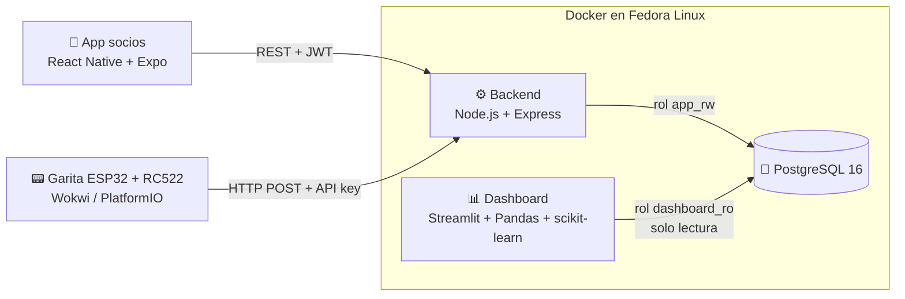
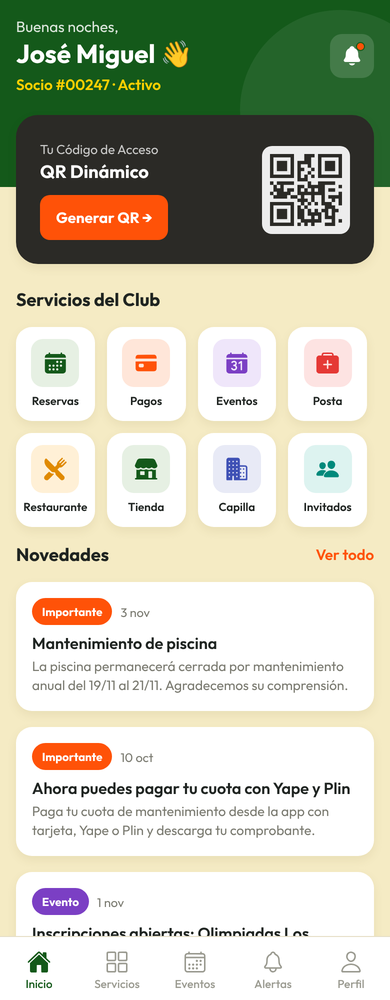
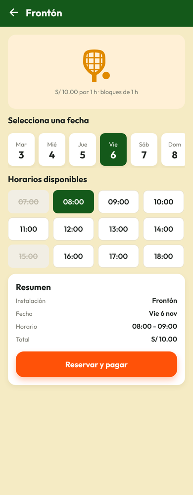
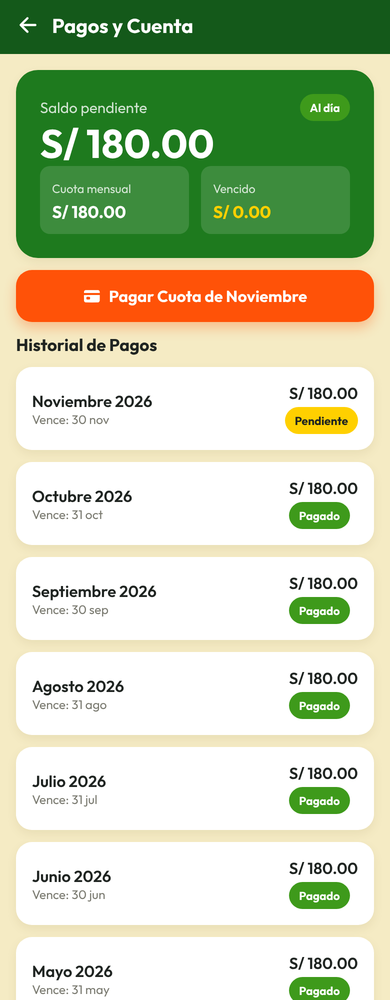
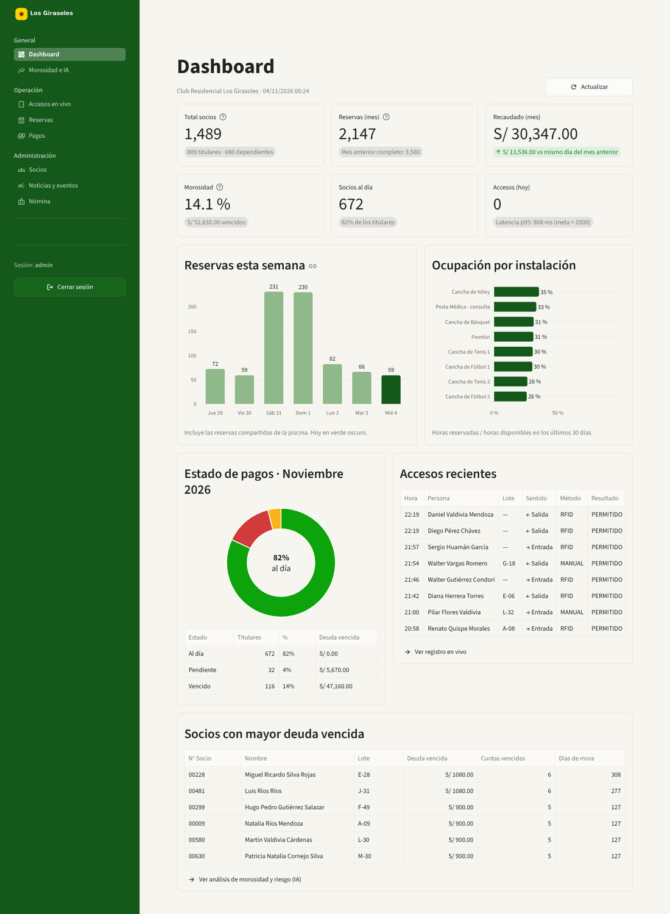
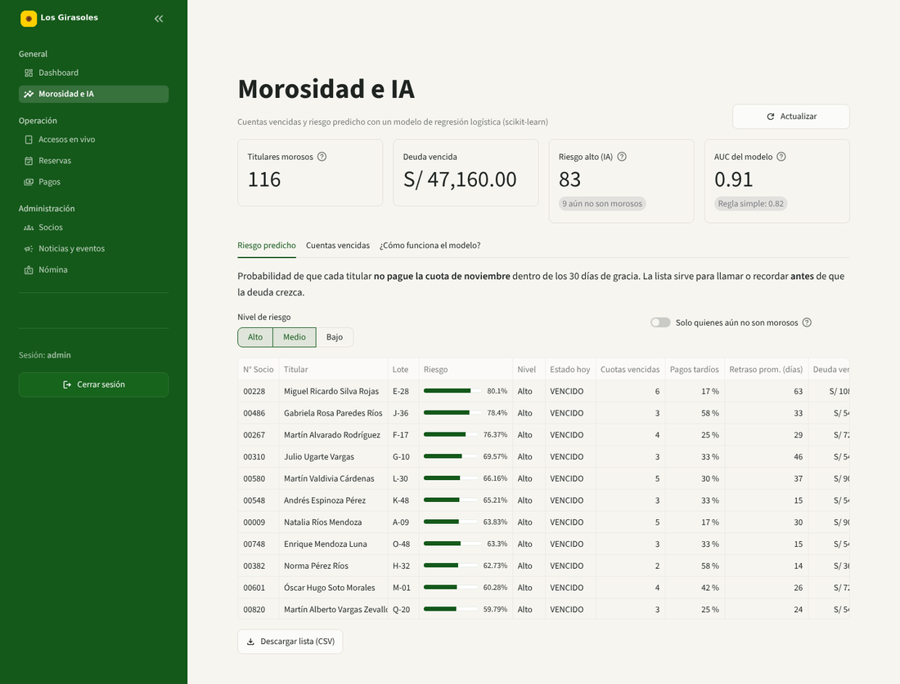

# Los Girasoles · Plataforma digital integral

Plataforma de gestión administrativa, reservas y control de acceso para el
**Club Residencial Los Girasoles de Huampaní** (≈1500 socios).

Trabajo final del curso **Diseño e Implementación en Ambientes Emergentes**
— Universidad San Ignacio de Loyola, Facultad de Ingeniería e Inteligencia Artificial.



## Avance por sprint

| Sprint | Entregable | Estado |
|---|---|---|
| 0 | Análisis, MER y arquitectura | ✅ |
| 1 | Base de datos, semilla de datos, Docker | ✅ |
| 2 | Backend: autenticación, socios, reservas, pagos, validación de acceso | ✅ |
| 3 | IoT: garita ESP32 + RFID simulada en Wokwi | ✅ |
| 4 | App móvil Expo | ✅ |
| 5 | Panel administrativo Streamlit + modelo de riesgo de morosidad (IA) | ✅ |
| 6 | Pruebas, evidencias e informe final | ⏳ |

## Estructura del repositorio

```
los-girasoles/
├── docker-compose.yml     # orquestación de contenedores
├── .env.example           # plantilla de variables de entorno
├── Makefile               # atajos: make up, make test-db, make reset...
├── database/
│   ├── init/              # se ejecutan solos al crear la BD
│   │   ├── 01_extensiones.sql
│   │   ├── 02_esquema.sql     # 23 tablas, tipos y restricciones
│   │   ├── 03_funciones.sql   # triggers, emisión de cuotas, nómina
│   │   ├── 04_vistas.sql      # vistas para el dashboard y estados de cuenta
│   │   ├── 05_semilla.sql     # datos ficticios de demostración
│   │   ├── 06_roles.sh        # roles con mínimo privilegio
│   │   └── 07_tarjetas_wokwi.sql  # UIDs de las tarjetas del simulador
│   └── tests/
│       └── pruebas_integridad.sql
├── backend/               # API REST Node.js + Express (Sprint 2)
│   ├── src/modules/       # auth, socios, reservas, pagos, accesos, invitados...
│   └── tests/             # 58 pruebas automáticas (Jest + Supertest)
├── iot/garita-esp32/     # firmware ESP32 (PlatformIO) + circuito Wokwi (Sprint 3)
├── mobile/                # app React Native + Expo SDK 58 (Sprint 4)
├── dashboard/             # panel administrativo Streamlit + Pandas (Sprint 5)
│   ├── paginas/           # dashboard, morosidad e IA, accesos en vivo, reservas, pagos...
│   ├── modelo/riesgo.py   # modelo de riesgo de morosidad (scikit-learn)
│   └── tests/             # 12 pruebas del modelo (pytest)
└── docs/
    ├── MER.md             # modelo entidad-relación y reglas de negocio
    ├── API.md             # referencia de todos los endpoints
    └── sprints/           # historias, decisiones y evidencias por sprint
```

## Puesta en marcha en Fedora Linux

### 1. Requisitos (una sola vez)

**Git y Make**
```bash
sudo dnf install -y git make
```

**Docker CE** (recomendado). Para Fedora 41 o superior:
```bash
sudo dnf -y install dnf-plugins-core
sudo dnf config-manager addrepo --from-repofile=https://download.docker.com/linux/fedora/docker-ce.repo
sudo dnf install -y docker-ce docker-ce-cli containerd.io docker-buildx-plugin docker-compose-plugin
sudo systemctl enable --now docker
sudo usermod -aG docker $USER      # luego cierra sesión y vuelve a entrar
docker run --rm hello-world         # comprobación
```

<details>
<summary>Alternativa: Podman (ya viene instalado en Fedora)</summary>

```bash
sudo dnf install -y podman-compose
# En cada comando de make agrega:  COMPOSE="podman compose"
make up COMPOSE="podman compose"
```
</details>

### 2. Clonar y levantar

```bash
git clone https://github.com/josetello30/los-girasoles.git
cd los-girasoles
make up
```

`make up` crea el archivo `.env` desde `.env.example`, construye el backend, descarga las imágenes y crea
la base de datos con todos los datos de demostración (la primera vez tarda unos minutos).

Sin Make, el equivalente es:
```bash
cp .env.example .env
docker compose up -d --build
```

### 3. Comprobar que todo funciona

```bash
make estado      # KPIs: debe mostrar ~1500 socios, recaudación del mes, morosidad...
make test-db     # 19 pruebas de integridad: todas deben decir [OK]
make test-api    # 58 pruebas de la API: todas deben pasar
make test-dashboard  # 12 pruebas del modelo de riesgo: todas deben pasar
curl localhost:3000/api/v1/health
```

La referencia completa de la API, con ejemplos para probarla desde la terminal, está en [`docs/API.md`](docs/API.md).

Abre **Adminer** en http://localhost:8080 para explorar la base de datos:

| Campo | Valor |
|---|---|
| Sistema | PostgreSQL |
| Servidor | `postgres` |
| Usuario | `girasoles` |
| Contraseña | `girasoles_dev_2026` |
| Base de datos | `girasoles` |

### 4. Actualizar en cada sprint

```bash
git pull
make env         # agrega a tu .env las variables nuevas del sprint (no toca las tuyas)
make migrar      # aplica los scripts nuevos de la BD sin borrar tus datos
make up          # reconstruye lo que haya cambiado
make reset       # SOLO si el sprint cambió archivos de database/init (borra y recrea la BD)
```

> Los scripts de `database/init` solo se ejecutan cuando el volumen está **vacío**.
> Si cambian, hay que ejecutar `make reset` para verlos aplicados.

### 5. App móvil

```bash
make app         # instala dependencias y abre Expo: escanea el QR con Expo Go
```
Guía completa (Node.js en Fedora, Expo Go, problemas de red): [`mobile/README.md`](mobile/README.md).

<p align="center">
  
  
  
  
</p>

### 6. Panel administrativo

Se levanta junto con todo lo demás (`make up`). Abre **http://localhost:8501** e ingresa con
`admin` / `Admin2026!`. Incluye el dashboard de KPIs, el **modelo de riesgo de morosidad**, el registro
de la garita **en vivo** (se actualiza cada 5 s: pasa una tarjeta en Wokwi y mírala aparecer), reservas,
pagos en ventanilla, socios, noticias/eventos y nómina.
Detalles y metodología del modelo: [`dashboard/README.md`](dashboard/README.md).

<p align="center">
  
  
</p>

## Credenciales de demostración

Todos los datos son **ficticios**. Estas credenciales son solo para el entorno de desarrollo.

| Perfil | Usuario | Contraseña | Uso |
|---|---|---|---|
| Socio de demo | `00247` (José Miguel Quispe Soto) | `Girasoles2026` | App móvil |
| Socio moroso | `00289` (Roberto Silva Castro) | `Girasoles2026` | Probar bloqueo de reservas |
| Cualquier socio | su número (`00001` … `00820`) | `Girasoles2026` | App móvil |
| Administrador | `admin` | `Admin2026!` | Panel administrativo |
| Guardia | `guardia01` | `Guardia2026!` | Validación de QR en garita |

| Tarjeta del simulador Wokwi | UID | Resultado esperado |
|---|---|---|
| Azul | `A1B2C3D4` | Socio 00247: permitido |
| Verde | `11223344` | Socio 00289 moroso: **permitido** (la deuda no impide entrar) |
| Amarilla | `55667788` | Personal de limpieza: permitido (asistencia) |
| Roja | `AABBCCDD` | Tarjeta perdida del socio 00247: denegado |
| Llavero | `C0FFEE99` | No registrada: denegado |
| Tag NFC | `04112233445566` | Socio 00150 suspendido: denegado |

Puedes probar cualquiera sin el simulador: `make tarjeta UID=11223344`.
La guía del simulador está en [`iot/garita-esp32/README.md`](iot/garita-esp32/README.md).

## Datos de demostración

La semilla genera datos **relativos a la fecha actual**, así el dashboard siempre muestra información "de hoy":

- 1500 socios (820 titulares con lote + 680 dependientes) y 25 trabajadores.
- 12 meses de cuotas de mantenimiento (S/ 180) y pagos con tres perfiles: puntual, irregular y moroso.
- ~13 000 reservas (últimos 90 días y próximas 2 semanas) en 14 instalaciones.
- ~13 000 registros de acceso (30 días de socios e invitados, 90 días de personal).
- Tienda con 8 productos y 70 pedidos; nómina simulada de 3 meses.

## Solución de problemas

| Síntoma | Causa probable | Solución |
|---|---|---|
| `permission denied` al leer `/docker-entrypoint-initdb.d` | SELinux bloquea el volumen | Verifica que el `docker-compose.yml` tenga `:Z` en los volúmenes |
| `address already in use` en el puerto 5433 | Otro programa usa ese puerto (`sudo ss -ltnp \| grep 5433`) | Cambia `POSTGRES_PORT` en `.env` (ej. 5434) y `docker compose up -d` |
| Adminer: `could not translate host name "postgres"` | El contenedor de la BD no arrancó (revisa `docker compose ps`) | Mira `docker compose logs postgres`; si es el puerto, ver fila anterior |
| Cambié un `.sql` y no se refleja | Los scripts solo corren con el volumen vacío | `make reset` |
| `permission denied ... docker.sock` | Tu usuario no está en el grupo docker | `sudo usermod -aG docker $USER` y vuelve a iniciar sesión |
| El panel muestra `Sin conexión con la base de datos` | El contenedor del panel arrancó antes que la BD o tu `.env` es antiguo | `make env && make up`; revisa `make logs-panel` |
| El celular (Expo Go) o Wokwi no llegan a la API | firewalld bloquea el puerto 3000 | `sudo firewall-cmd --add-port=3000/tcp --permanent && sudo firewall-cmd --reload && sudo systemctl restart docker && make up` |
| Tras recargar firewalld los contenedores no se ven entre sí | firewalld borra las reglas de red de Docker | `sudo systemctl restart docker && make up` (siempre después de `firewall-cmd --reload`) |
| `Define JWT_SECRET en .env` al levantar | Tu `.env` es de un sprint anterior | `make env` |

## Equipo

- Portocarrero Huallullo, Pier Antoni
- Tello Saaz, José Miguel

Profesor: Navarro Vela, Herbert Francisco.
