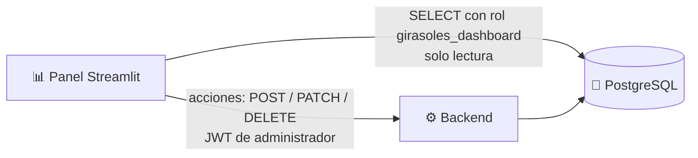
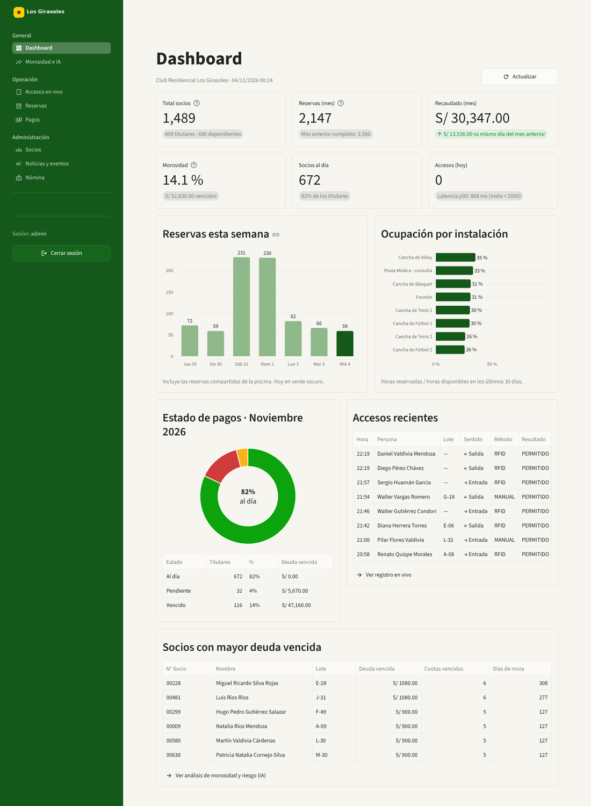
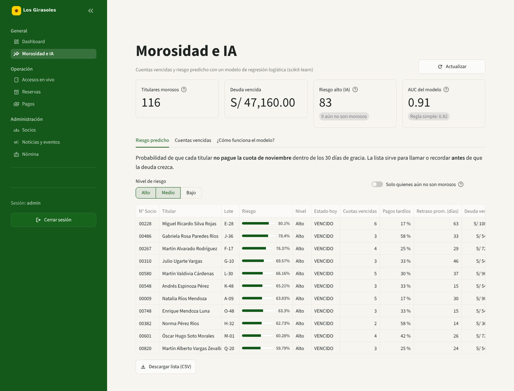
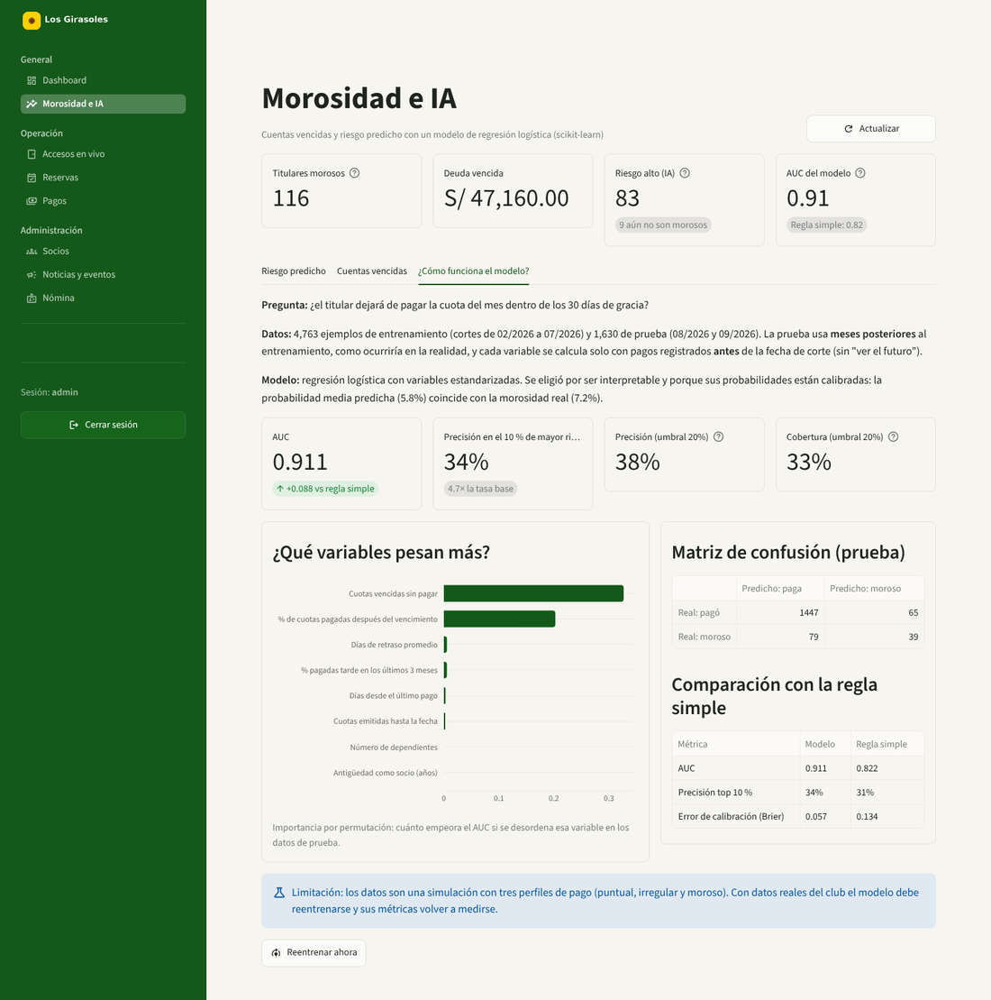
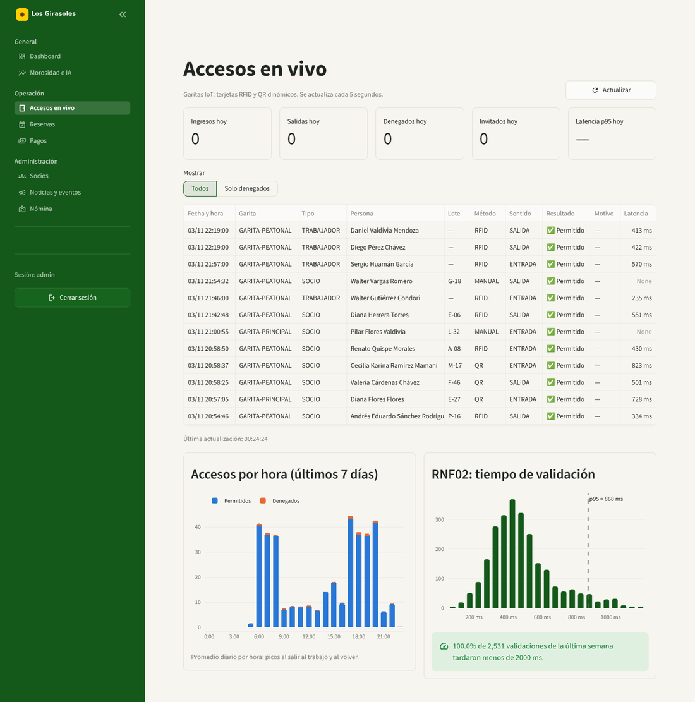

# Panel administrativo · Streamlit + Pandas + scikit-learn

Panel web para la administración del club: KPIs, morosidad con **modelo de riesgo (IA)**,
accesos de la garita **en vivo**, reservas, pagos, socios, comunicaciones y nómina.



- **Lectura** directa de la BD con un rol de **solo lectura** que además no puede ver usuarios,
  contraseñas, tokens QR ni claves de dispositivos.
- **Escritura** siempre a través de la API (publicar noticias, pago en ventanilla, bloquear una
  instalación, cambiar el estado de un socio, generar o cerrar una planilla). Así todas las
  reglas de negocio y validaciones son las mismas que usa la app móvil.

## Ejecutar

Con Docker (recomendado), desde la raíz del repositorio:

```bash
make up              # levanta BD, backend y panel
# abre http://localhost:8501   ->  admin / Admin2026!
make test-dashboard  # 12 pruebas del modelo de riesgo (pytest)
make logs-panel      # logs de Streamlit
```

Sin Docker (para desarrollar el panel con recarga automática):

```bash
cd dashboard
python3 -m venv .venv && source .venv/bin/activate
pip install -r requirements.txt -r requirements-dev.txt
export DB_PORT=5433 DB_PASSWORD=dashboard_dev_2026     # la BD de Docker en el host
streamlit run app.py
pytest -v
```

| Variable | Por defecto | Descripción |
|---|---|---|
| `DB_HOST` / `DB_PORT` | `localhost` / `5433` | PostgreSQL |
| `DB_NAME` | `girasoles` | Base de datos |
| `DB_USER` / `DB_PASSWORD` | `girasoles_dashboard` / — | Rol de solo lectura |
| `API_URL` | `http://localhost:3000/api/v1` | Backend para las acciones |

## Páginas

| Página | Qué muestra / permite | Requisito |
|---|---|---|
| Dashboard | 6 KPIs, reservas de la semana, ocupación, estado de pagos, accesos recientes, mayores deudores | RF04, RF05 |
| Morosidad e IA | Riesgo predicho por titular (descargable en CSV), deuda por antigüedad, explicación del modelo | IA |
| Accesos en vivo | Registro de la garita que se actualiza **cada 5 s**, accesos por hora, evidencia del RNF02 | RF05, RNF02 |
| Reservas | Mapa de calor día × hora, ocupación, agenda del día, bloqueo de instalaciones | RF02 |
| Pagos | Recaudación mensual, medios de pago, registro de pago en ventanilla | RF04 |
| Socios | Padrón filtrable, ficha del socio, bloqueo de tarjeta, cambio de estado | RF04 |
| Noticias y eventos | Publicar / retirar noticias en la app, crear eventos, inscripciones por disciplina | RF03 |
| Nómina | Planillas (simuladas), boletas, generar y cerrar planilla, asistencia del personal | — |

## Modelo de riesgo de morosidad

### Pregunta que responde

> ¿Este titular **dejará de pagar** la cuota del mes dentro de los **30 días de gracia**?

Sirve para actuar **antes** de que la deuda crezca: llamar, recordar o proponer un fraccionamiento
a quienes tienen más probabilidad de caer en mora, incluidos los que **hoy todavía están al día**.

### Datos y variables

Cada ejemplo es un par *(titular, mes de corte)*. Las variables se calculan **solo con información
registrada antes de la fecha de corte**. Por ejemplo, una cuota pagada después del corte cuenta como
impaga en ese corte. Así el modelo no "ve el futuro" (sin fuga de información).

| Variable | Significado |
|---|---|
| `cuotas_impagas` | Cuotas ya vencidas y no canceladas a la fecha de corte |
| `pct_pagadas_tarde` | % de cuotas históricas pagadas después del vencimiento |
| `retraso_promedio` | Días promedio de retraso al pagar |
| `pct_tarde_reciente` | % de pagos tardíos en los últimos 3 meses |
| `dias_sin_pagar` | Días desde el último pago |
| `cuotas_historicas` | Cuotas emitidas hasta el corte |
| `antiguedad_anios` | Años como socio |
| `dependientes` | Tamaño del grupo familiar |

**Etiqueta:** 1 si la cuota que vence en el mes de corte **no** quedó cancelada dentro de los 30 días
siguientes al vencimiento. Solo se usan cortes cuya etiqueta ya es observable: con la fecha de hoy
(04/11/2026), el último corte etiquetado es septiembre de 2026.

### Entrenamiento y validación

- `Pipeline(StandardScaler, LogisticRegression)` de scikit-learn.
- **Validación temporal**: entrena con los cortes de 02/2026 a 07/2026 (4 763 filas) y evalúa con
  08/2026 y 09/2026 (1 630 filas), que son meses **posteriores**. Es la situación real: predecir
  meses que el modelo nunca vio.
- Se compara contra una **regla simple** ("tiene alguna cuota vencida") para comprobar que el modelo
  aporta algo más que el sentido común.
- Importancia de variables por **permutación**: cuánto cae el AUC si se desordena cada variable.

### Resultados (datos de prueba)

| Métrica | Modelo | Regla simple |
|---|---|---|
| AUC | **0.911** | 0.822 |
| Precisión en el 10 % de mayor riesgo | **34 %** (4.7× la tasa base de 7.2 %) | 31 % |
| Error de calibración (Brier, menor es mejor) | **0.057** | 0.134 |
| Probabilidad media predicha vs. morosidad real | 5.8 % vs. 7.2 % | — |
| Precisión / cobertura con umbral 20 % | 38 % / 33 % | — |

Las variables que más pesan son `cuotas_impagas` (0.327) y `pct_pagadas_tarde` (0.203).
Niveles en el panel: **Alto** ≥ 20 %, **Medio** ≥ 10 %, **Bajo** < 10 %.

### Decisiones y lecciones

1. **Sin `class_weight="balanced"`**. La primera versión lo usaba y la probabilidad media predicha era
   31 % frente a una morosidad real del 7 %. Para un panel que muestra "% de riesgo" importa más que
   la probabilidad sea creíble (calibrada) que maximizar la cobertura.
2. **Se eliminaron variables colineales** (la deuda es exactamente 180 × cuotas impagas). Con ellas
   los coeficientes cambiaban de signo y no se podían interpretar. Se muestran como datos
   descriptivos, no como variables del modelo.
3. **Importancia por permutación en lugar de coeficientes**, porque es más honesta cuando las
   variables están correlacionadas.
4. **Regresión logística** en lugar de un modelo más complejo: es interpretable, rápida (se reentrena
   en segundos al abrir el panel; caché de 1 h) y sus probabilidades salen calibradas.

### Limitaciones

Los pagos son **simulados** con tres perfiles (puntual, irregular y moroso), así que las métricas
son optimistas respecto a datos reales. Con el historial real del club el modelo debe reentrenarse
(botón *Reentrenar ahora* en la página) y sus métricas volver a medirse.

## Estructura

```
dashboard/
├── app.py                 # login de administrador y navegación
├── componentes.py         # colores, estilo de gráficos, encabezados, llamadas a la API
├── paginas/               # una página por sección del menú
├── servicios/
│   ├── config.py          # variables de entorno
│   ├── datos.py           # consultas SQL -> DataFrames (Pandas)
│   ├── cache.py           # caché de Streamlit (datos y modelo)
│   └── api.py             # cliente del backend
├── modelo/riesgo.py       # variables, etiqueta, entrenamiento y predicción
├── tests/test_riesgo.py   # 12 pruebas: fuga de información, etiqueta, calibración...
├── recursos/logo.png
├── .streamlit/config.toml # tema con los colores del club
└── Dockerfile             # etapas: pruebas / produccion
```

## Capturas

| | |
|---|---|
|  |  |
|  |  |
