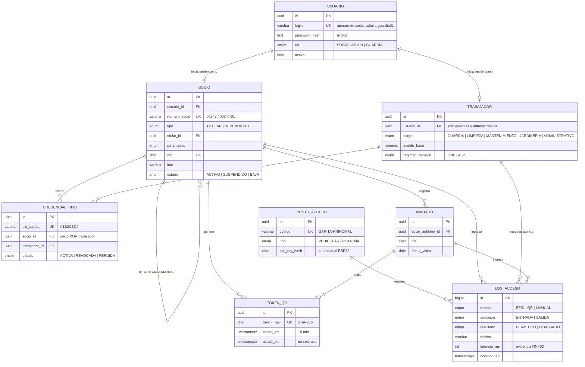
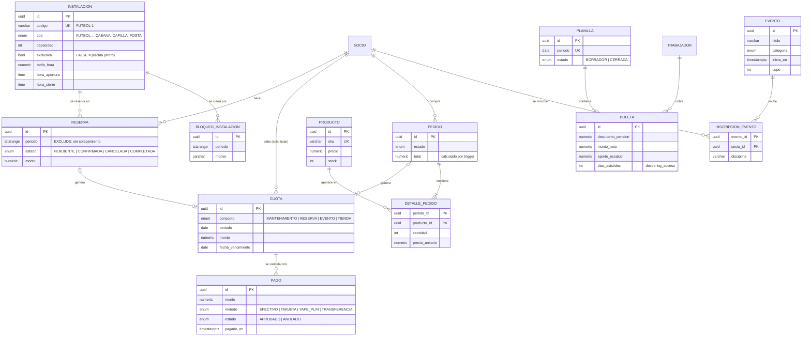

# Modelo Entidad-Relación

Base de datos PostgreSQL 16 del Club Residencial Los Girasoles de Huampaní.
El DDL completo está en [`database/init/02_esquema.sql`](../database/init/02_esquema.sql).
GitHub dibuja automáticamente los diagramas de abajo.

## 1. Personas, seguridad y control de acceso

## 2. Reservas, pagos, tienda y nómina

Tablas de apoyo sin relaciones relevantes: `noticia`, `servicio_club` y `parametro`
(configuración de negocio editable sin redesplegar).

## 3. Reglas de negocio que garantiza la base de datos

| Regla | Mecanismo | Error |
|---|---|---|
| Dos reservas activas no se solapan en canchas y cabañas | `EXCLUDE USING gist` sobre `tstzrange` | 23P01 |
| La piscina no supera su aforo | Trigger + candado transaccional | GR005 |
| No se reserva fuera de horario ni durante mantenimientos | Trigger `fn_validar_reserva` | GR002 / GR004 |
| La deuda siempre es del titular, nunca de un dependiente | Trigger `fn_validar_cuota` | GR010 |
| Un pago no supera el saldo de su cuota (aun con pagos simultáneos) | Trigger con `SELECT ... FOR UPDATE` | GR011 |
| Una sola cuota de mantenimiento por titular y mes | Índice único parcial | 23505 |
| Una tarjeta RFID pertenece a un socio **o** a un trabajador | `CHECK num_nonnulls(...) = 1` | 23514 |
| El log de accesos y los pagos no se editan ni se borran | `REVOKE UPDATE, DELETE` al rol del backend | 42501 |
| El dashboard no ve contraseñas, tokens ni API keys | `REVOKE SELECT` + sesión de solo lectura | 42501 |

Las 19 pruebas automáticas de estas reglas están en
[`database/tests/pruebas_integridad.sql`](../database/tests/pruebas_integridad.sql) (`make test-db`).

## 4. Estado de cuenta (vista `v_estado_cuenta`)

Los estados se **calculan** a partir de cuotas y pagos; no se guardan, así nunca quedan desincronizados.

| Estado | Significado | ¿Puede reservar? | ¿Puede ingresar? |
|---|---|---|---|
| `AL_DIA` | Sin cuotas vencidas (puede tener la cuota del mes aún por vencer) | Sí | Sí |
| `PENDIENTE` | Cuotas vencidas dentro del periodo de gracia (30 días) | Sí | Sí |
| `VENCIDO` | Alguna cuota supera el periodo de gracia: **moroso** | No | **Sí** |

La morosidad **nunca** bloquea el ingreso: es un club residencial y los socios viven ahí.
La garita solo deniega por credencial inválida, revocada o QR expirado.
