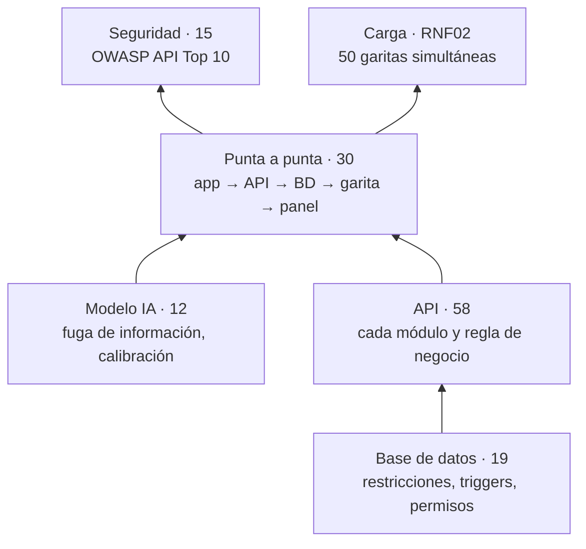

# Plan y resultados de pruebas

Este documento reúne **cómo se verificó** que la plataforma cumple sus requerimientos: qué se
probó, con qué herramienta, dónde está la prueba y cuál fue el resultado. Las salidas completas
están en [`docs/evidencias`](evidencias/).

## Cómo reproducir todo

Con el sistema levantado (`make up`):

```bash
make evidencias   # ejecuta TODAS las pruebas y guarda los resultados en docs/evidencias/
```

| Comando | Qué ejecuta | Pruebas | Herramienta |
|---|---|---|---|
| `make test-db` | Integridad de la base de datos | 19 | SQL (PL/pgSQL) |
| `make test-api` | API REST por módulo | 58 | Jest + Supertest |
| `make test-dashboard` | Modelo de riesgo de morosidad | 12 | pytest |
| `make test-e2e` | Flujos de punta a punta y seguridad sobre el sistema levantado | 45 | `node:test` (Node 22) |
| `make test-lector` | Lector QR con cámara web (QR fotografiados, video de prueba, Wokwi simulado) | 19 | pytest + OpenCV |
| `make carga` | Carga de la garita con 1 a 50 lecturas simultáneas (RNF02) | 4 niveles × 200 | Node 22 |
| **Total automatizado** | | **153 pruebas + prueba de carga** | |

En GitHub, el pipeline de integración continua (`.github/workflows/ci.yml`) ejecuta todo esto en cada
`push` a `main`, además de compilar el firmware y revisar la app móvil. Las evidencias de cada
ejecución se descargan desde la pestaña **Actions**.

## Niveles de prueba



1. **Base de datos:** las reglas críticas viven en PostgreSQL (no solapar reservas, aforo,
   pagos que no superan el saldo, permisos por rol), así que se prueban ahí directamente:
   aunque alguien se salte la API, la BD rechaza el dato inválido.
2. **API:** cada endpoint y cada regla de negocio (morosidad, ventana de 14 días, límite de
   reservas, pasarela simulada, QR de un solo uso).
3. **Modelo de IA:** que las variables no usen información del futuro, que la etiqueta respete
   los 30 días de gracia, que las probabilidades estén calibradas.
4. **Punta a punta:** los flujos que cruzan componentes, contra el sistema real levantado en
   Docker, usando los mismos contratos HTTP que la app móvil, el panel y el firmware del ESP32.
5. **Seguridad:** pruebas de caja negra sobre la API expuesta.
6. **Carga:** varias garitas validando a la vez para medir el RNF02 bajo presión.

## Matriz de trazabilidad

| Requerimiento | Cómo se verifica | Prueba(s) | Resultado |
|---|---|---|---|
| **RF01** Autenticación con N° de socio y QR dinámico (5 min) | El socio inicia sesión, genera el QR, la garita lo valida; el QR no se reutiliza | E2E-01 · API "QR dinámico (RF01)" · app: recorrido Playwright (Sprint 4) | ✅ |
| **RF02** Reservas con disponibilidad en tiempo real | Disponibilidad → reserva → pago → confirmada → visible en la agenda → otro socio no puede tomarla → cancelación la libera | E2E-04, E2E-06 · API "Ciclo completo", "Disponibilidad" · BD R01–R06 | ✅ |
| **RF03** Novedades y avisos | El panel publica una noticia importante, la app la muestra arriba, al retirarla desaparece | E2E-07 · API M01–M03 | ✅ |
| **RF04** Métricas consolidadas en el panel | KPIs desde vistas SQL; recorrido automatizado de las 8 páginas sin errores | Recorrido Playwright del panel (Sprint 5) · capturas `docs/capturas/panel` | ✅ |
| **RF05** Estado de pagos y registro de accesos en vivo | Cada lectura de la garita aparece en el registro en vivo; el pago en ventanilla se refleja al instante | E2E-01, E2E-02, E2E-05 · panel "Accesos en vivo" (refresco 5 s) | ✅ |
| **RNF01** Contenerizado con Docker en Fedora | Toda la plataforma se levanta con `make up`; healthchecks de BD, API y panel | E2E-09 · `docs/evidencias/contenedores.txt` | ✅ |
| **RNF02** Validación de acceso < 2 s | Cada validación E2E se cronometra; carga con hasta 50 lecturas simultáneas | E2E-01/02 · API "RNF02" · [`carga-garita.md`](evidencias/carga-garita.md) | ✅ p95 ≤ 184 ms |
| **RNF03** App multiplataforma | Un solo código Expo; probado en celular con Expo Go y en la versión web | TypeScript estricto + ESLint (Sprint 4) · prueba manual en celular | ✅ |
| Regla: la morosidad bloquea reservas, **no** el ingreso | El socio moroso recibe 403 al reservar y su tarjeta abre la garita | E2E-03 · API N01 | ✅ |
| Regla: invitados con QR del día | El socio registra al invitado y este ingresa | E2E-08 · API I01–I03 | ✅ |
| IA: modelo de riesgo de morosidad | Validación temporal, sin fuga de información, comparación con regla simple | 12 pruebas pytest · AUC 0.911 vs 0.822 | ✅ |
| Seguridad: mínimo privilegio en la BD | El backend no borra el log ni altera pagos; el panel no lee contraseñas ni escribe | BD S01–S05 | ✅ |
| Seguridad: API | Ver la sección siguiente | SEG-01 a SEG-05 | ✅ |

## Pruebas de punta a punta

| ID | Flujo | Componentes |
|---|---|---|
| E2E-01 | Socio genera QR en la app → garita lo valida en < 2 s → el QR no sirve dos veces → aparece en el registro en vivo | App, API, BD, garita, panel |
| E2E-02 | Las 6 tarjetas del simulador Wokwi dan el resultado esperado, con mensaje apto para el LCD 16×2 | Garita, API, BD |
| E2E-03 | El moroso no puede reservar (con el monto adeudado en el mensaje) pero sí ingresa | App, API, garita |
| E2E-04 | Reserva con tarifa → tarjeta rechazada (402) → tarjeta válida → confirmada → en la agenda → cancelación | App, pasarela simulada, API, panel |
| E2E-05 | Pago en ventanilla desde el panel → la deuda baja al instante en la app | Panel, API, app |
| E2E-06 | Mantenimiento programado desde el panel → la franja deja de estar disponible en la app | Panel, API, app |
| E2E-07 | Noticia importante publicada en el panel → arriba en la app → al retirarla desaparece | Panel, API, app |
| E2E-08 | Invitado registrado en la app → la garita lo deja pasar con su QR | App, API, garita |
| E2E-09 | La API, su base de datos y el panel están saludables | Docker |

## Pruebas de seguridad (OWASP API Security Top 10)

| ID | Qué se intenta | Resultado esperado | OWASP |
|---|---|---|---|
| SEG-01 | Entrar sin token, con un JWT alterado (rol ADMIN falsificado), adivinar usuarios por el mensaje de error, usar la garita sin clave | 401 en todos los casos; mismo mensaje para usuario inexistente y contraseña incorrecta | API2 Autenticación rota |
| SEG-02 | Socio en rutas de administración, socio pagando la cuota de otro, guardia viendo la nómina | 403 / 404 | API1 y API5 Autorización rota |
| SEG-03 | Inyección SQL en la búsqueda y en el UID de la garita, datos mal formados, cuerpo de 200 KB | Se trata como texto; 400 con detalle por campo; 413 | API8 Configuración insegura |
| SEG-04 | Buscar el hash de la contraseña en el perfil, cabeceras que revelen la tecnología, trazas en errores | No se expone; `helmet` activo; errores sin SQL ni trazas | API3 Exposición de datos |
| SEG-05 | 12 contraseñas erradas cambiando `X-Forwarded-For` en cada intento | Bloqueo 429 tras 10 intentos, aunque se falsifique la IP | API4 Consumo sin límites |

## Resultados de la prueba de carga (RNF02)

Lecturas de tarjeta concurrentes contra `POST /accesos/validar`, 200 por nivel, medidas desde el
cliente (ida y vuelta HTTP completa):

| Garitas simultáneas | Lecturas/s | p50 | p95 | p99 | Máximo | < 2000 ms | Errores |
|---|---|---|---|---|---|---|---|
| 1 | 198 | 4 ms | 8 ms | 11 ms | 16 ms | 100 % | 0 |
| 10 | 382 | 23 ms | 48 ms | 87 ms | 101 ms | 100 % | 0 |
| 25 | 495 | 47 ms | 77 ms | 124 ms | 141 ms | 100 % | 0 |
| 50 | 546 | 76 ms | 184 ms | 197 ms | 217 ms | 100 % | 0 |

Con 50 lecturas simultáneas (el club tiene una garita principal) el 95 % responde en menos de
**0.2 s**, diez veces por debajo de la meta de 2 s. Valores del entorno de desarrollo; `make carga`
los vuelve a medir en el servidor Fedora.

## Defectos encontrados y corregidos en este sprint

| # | Defecto | Cómo se encontró | Corrección |
|---|---|---|---|
| 1 | La API confiaba en `X-Forwarded-For` sin tener un proxy delante: un atacante podía cambiar esa cabecera en cada intento y **saltarse el límite de intentos de login** | Revisión de seguridad al diseñar SEG-05 | `trust proxy` configurable con `TRUST_PROXY`, desactivado por defecto |
| 2 | Un cuerpo mayor a 100 KB devolvía **500** (error del servidor) en lugar de **413** | SEG-03 | El manejador de errores lo traduce a 413 con mensaje en español |
| 3 | Dos pruebas de la API esperaban una deuda fija de S/ 540 del socio moroso, pero la semilla es relativa a la fecha: al vencer cada mes la deuda sube y la prueba fallaba | Al ejecutar la suite el 04/11 | La prueba compara contra su propio estado de cuenta |
| 4 | La prueba de invitados usaba siempre la misma familia, que agotaba su cupo de 8 invitados al mes tras unas pocas ejecuciones | Al ejecutar la suite varias veces seguidas | Elige una familia con cupo disponible |
| 5 | La prueba de BD P02 dependía de que el socio de demo 00247 (puntual) tuviera una cuota pendiente, lo que no ocurre en los primeros días del mes | Primera ejecución del pipeline de integración continua | Usa cualquier cuota con saldo |

## Pruebas manuales de demostración

| Prueba | Pasos | Resultado |
|---|---|---|
| Garita en Wokwi | Build en PlatformIO, iniciar el simulador, acercar cada tarjeta | LED verde y barrera (servo) para permitidos; LED rojo y zumbador para denegados; mensaje en el LCD |
| QR en Wokwi | Copiar el código del QR desde la app y pegarlo en el monitor serial | Ingreso permitido; segundo intento denegado |
| App en el celular | `make app` y escanear con Expo Go | Login, QR, reservas, pagos y eventos funcionan en el celular |
| Registro en vivo | Panel en "Accesos en vivo" mientras se pasa una tarjeta en Wokwi | El acceso aparece en ≤ 5 s sin recargar |
