# Sprint 4 · App móvil (React Native + Expo SDK 58)

**Objetivo del sprint:** que los 1500 socios gestionen desde el celular su acceso, reservas, pagos,
eventos y comunicaciones, siguiendo el prototipo UX/UI de Figma y consumiendo la API del Sprint 2.

## Historias completadas

| ID | Historia | Criterio de aceptación | Estado |
|---|---|---|---|
| HU-24 | Como socio quiero entrar con mi número de socio | Sesión guardada de forma segura; se recupera al reabrir la app | ✅ |
| HU-25 | Como socio quiero mi QR de acceso en el celular (RF01) | QR de un solo uso con cuenta regresiva de 5 min y renovación automática | ✅ |
| HU-26 | Como socio quiero ver la disponibilidad y reservar (RF02) | Franjas por día; reserva con tarifa → pago → confirmada | ✅ |
| HU-27 | Como socio quiero pagar mi cuota desde la app | Tarjeta o Yape/Plin; comprobante con número de operación | ✅ |
| HU-28 | Como socio moroso quiero saber por qué no puedo reservar | Aviso en el inicio y mensaje con el monto vencido | ✅ |
| HU-29 | Como socio quiero enterarme de las novedades (RF03) | Alertas con las importantes primero | ✅ |
| HU-30 | Como socio quiero inscribirme en las olimpiadas | Elección de disciplina; sin doble inscripción | ✅ |
| HU-31 | Como socio quiero invitar a alguien | QR del día para compartir por WhatsApp | ✅ |
| HU-32 | Como socio quiero bloquear mi tarjeta si la pierdo | "Reportar pérdida" en el perfil: efecto inmediato en la garita | ✅ |
| HU-33 | Como socio quiero comprar merchandising (simulado) | Carrito con stock y pago | ✅ |

## Decisiones técnicas

1. **Expo SDK 58** (React Native 0.88, React 19.3): la versión vigente que soporta **Expo Go 58** de las tiendas,
   para probar en cualquier celular sin compilar una app nativa.
2. **Expo Router con rutas protegidas** (`Stack.Protected`): sin sesión solo existe la pantalla de login,
   no hay forma de navegar a una pantalla interna por error.
3. **Token en SecureStore** (Keychain en iOS, Keystore en Android), nunca en almacenamiento plano.
4. **Detección automática del backend** a partir de la IP con la que Expo Go se conecta a la PC:
   no hay que editar la IP cada vez que cambia la red.
5. **El QR se renueva con reloj local** (vigencia recibida + hora del celular) para no depender de que
   el reloj del teléfono coincida con el del servidor.
6. **Diseño fiel al prototipo**: paleta, tipografía Outfit, tarjetas y barra inferior tomadas del Figma.
7. **"Copiar código" en la pantalla del QR**: permite pegar el QR en el monitor serial de Wokwi y demostrar
   el flujo completo app → garita IoT → backend en la exposición.

## Verificación

| Control | Resultado |
|---|---|
| TypeScript estricto + rutas tipadas | 0 errores |
| ESLint (configuración oficial de Expo) | 0 advertencias |
| expo-doctor | 18/20 (las 2 restantes requieren conexión a servidores de Expo; ejecutar en la PC del equipo) |
| Recorrido automatizado E2E (Playwright, versión web contra la API real) | Login → QR → reserva → pago → mis reservas → pagos → eventos → inscripción → perfil → socio moroso bloqueado |

El recorrido E2E generó las capturas de [`docs/capturas/app-movil`](../capturas/app-movil/), útiles para el informe.

## Capturas

| | | |
|---|---|---|
| 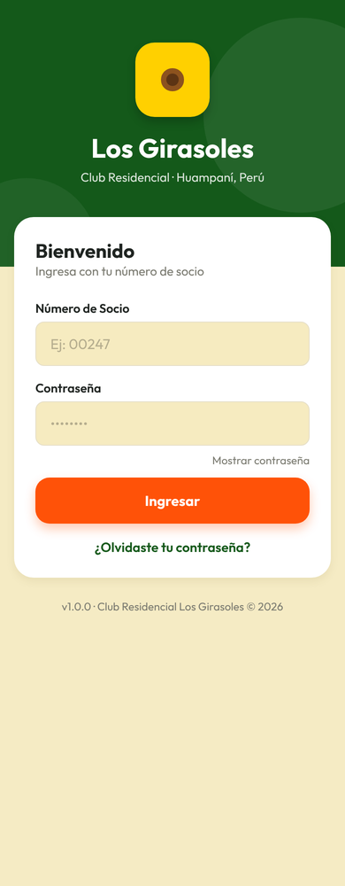 | 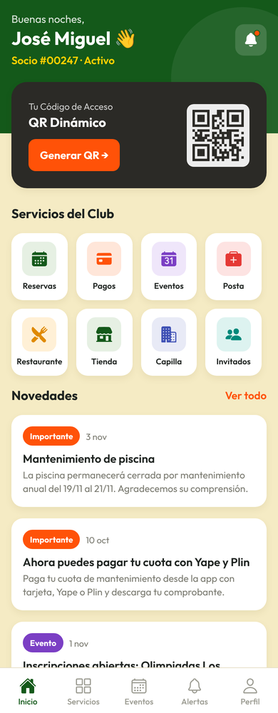 | 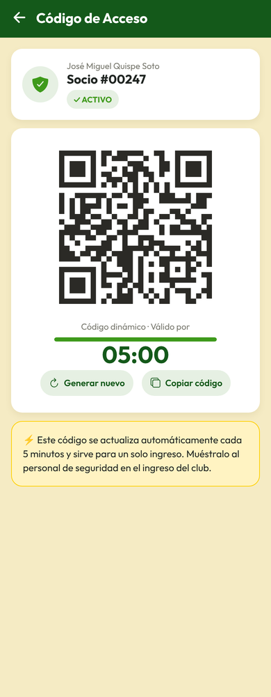 |
| 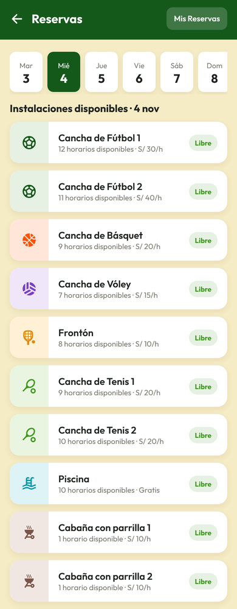 | 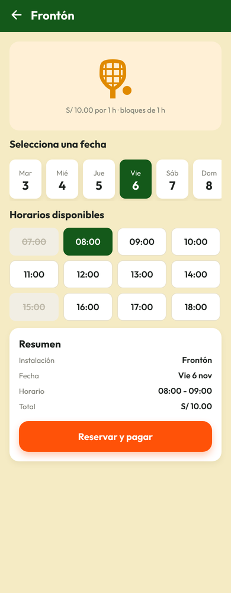 | 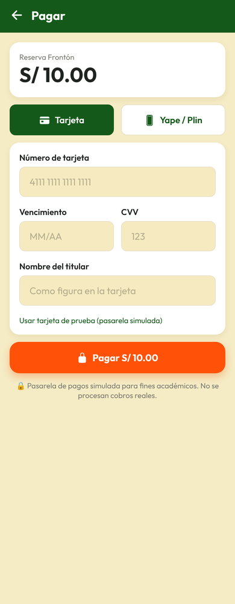 |
| 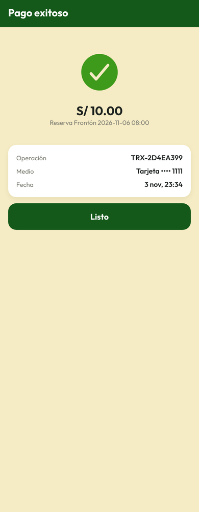 | 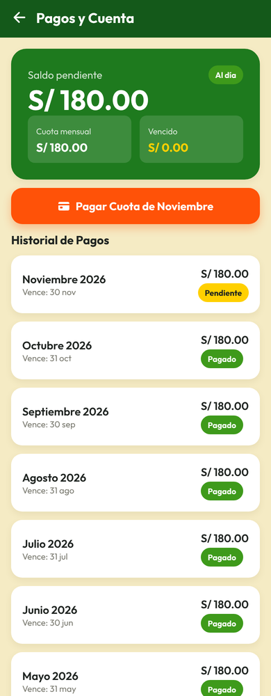 | 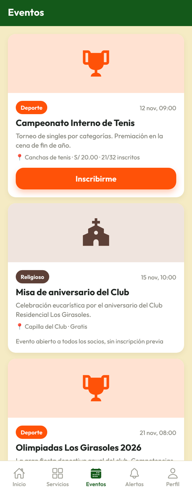 |
| 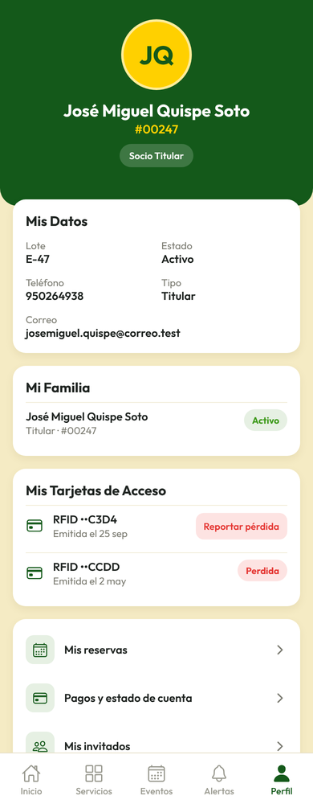 | 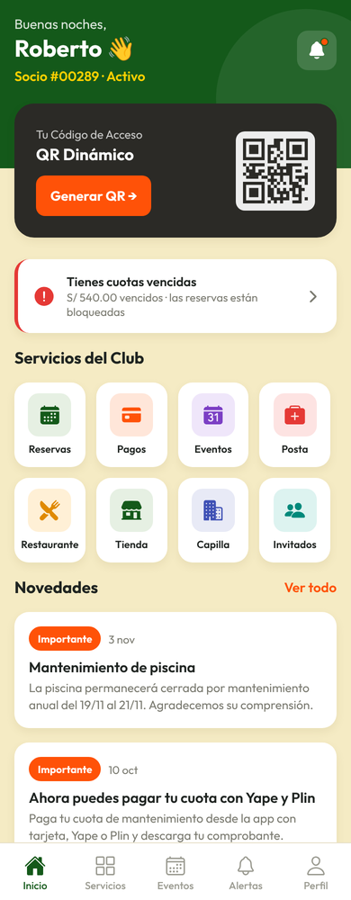 | 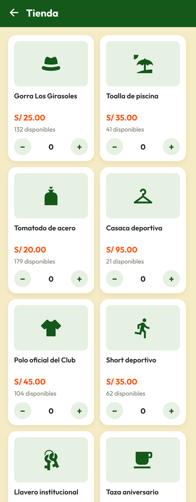 |
