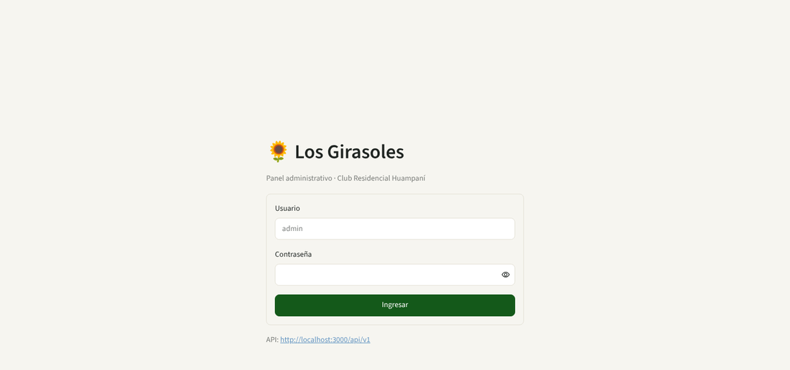
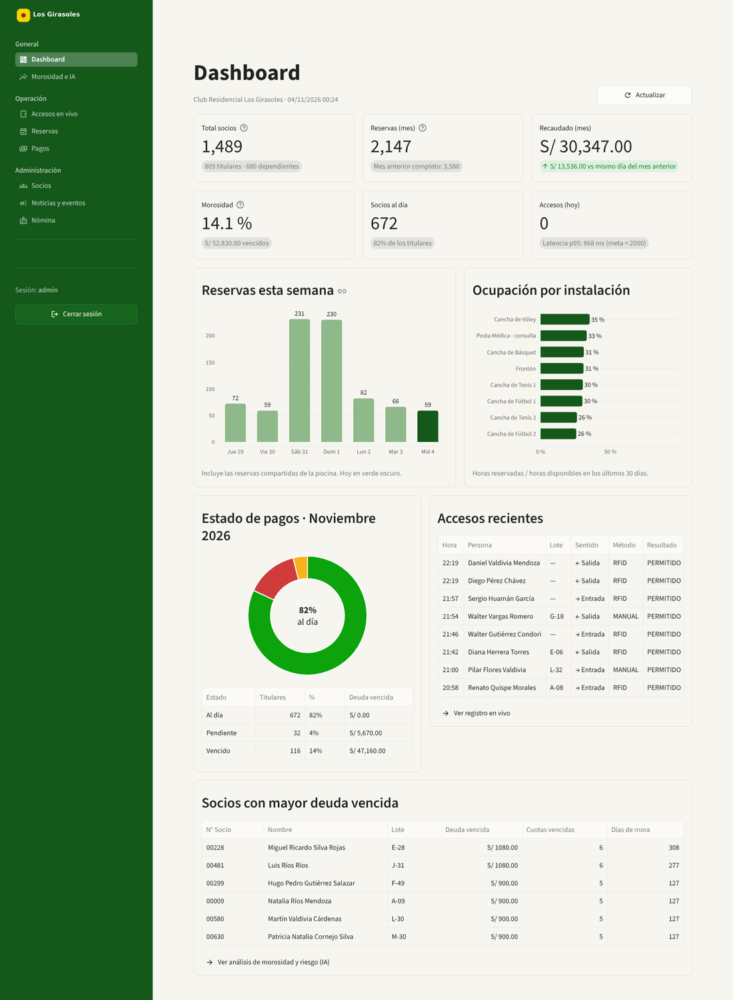
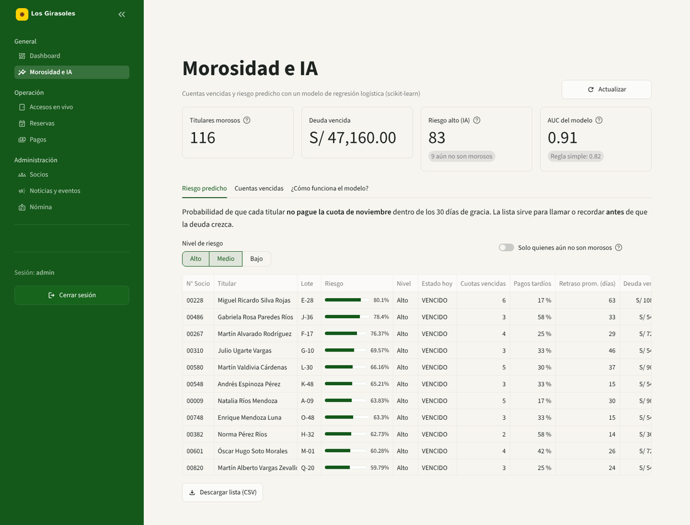
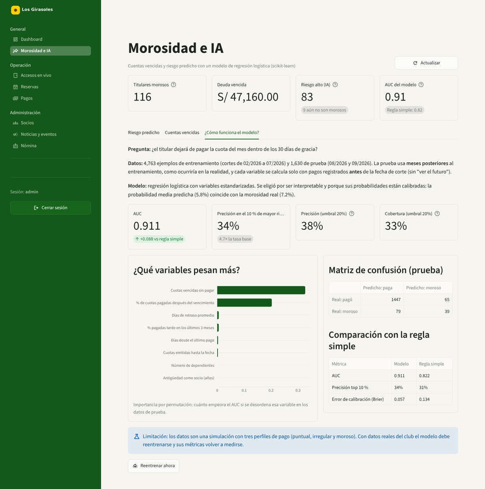
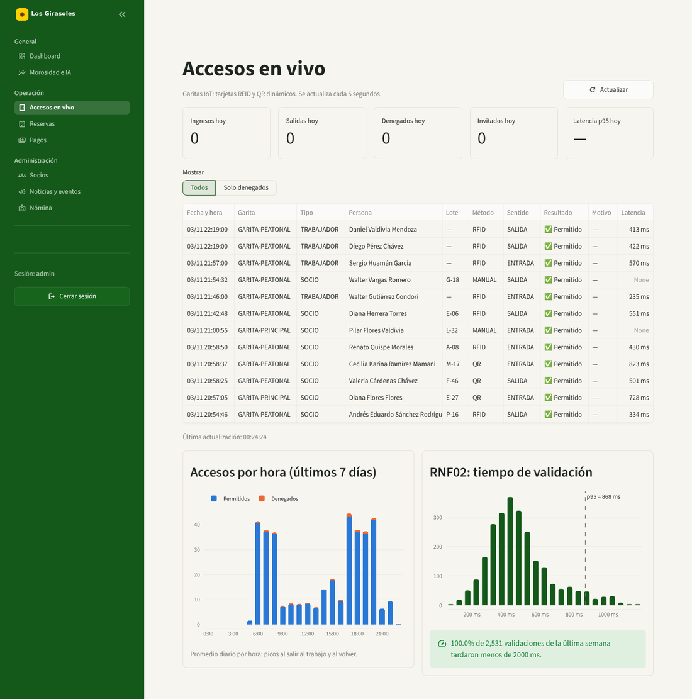
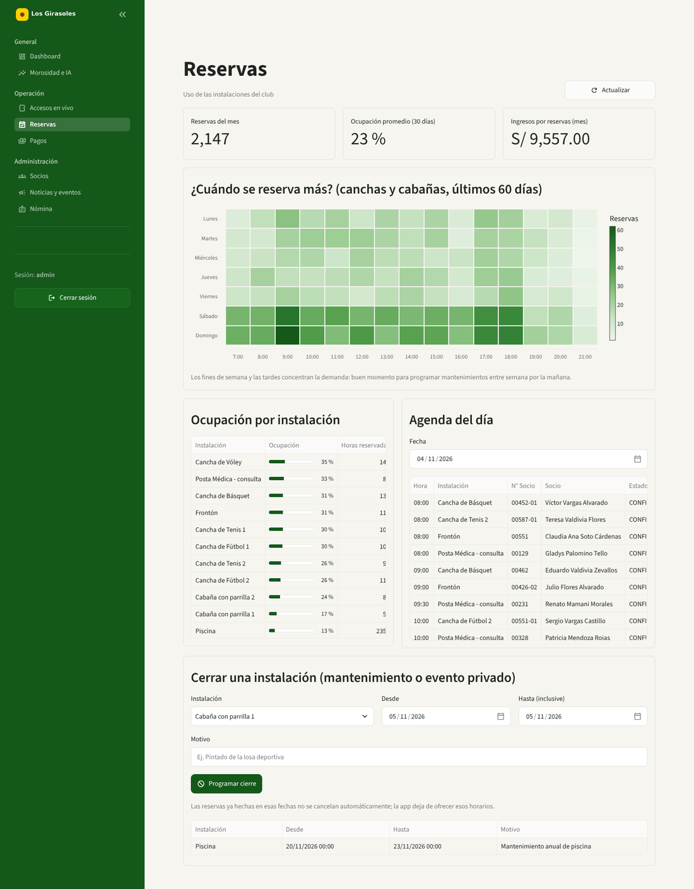
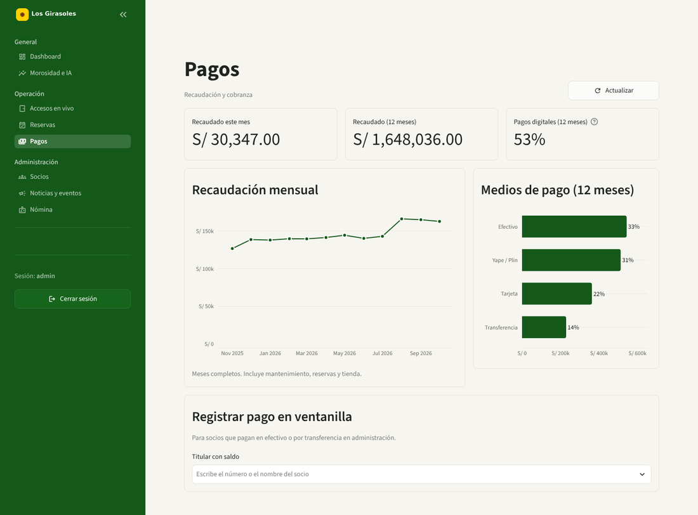
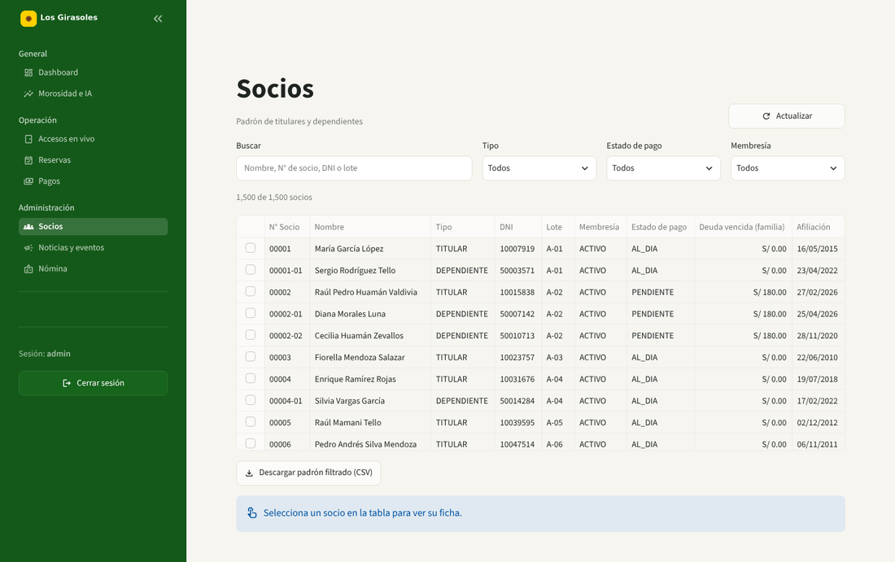
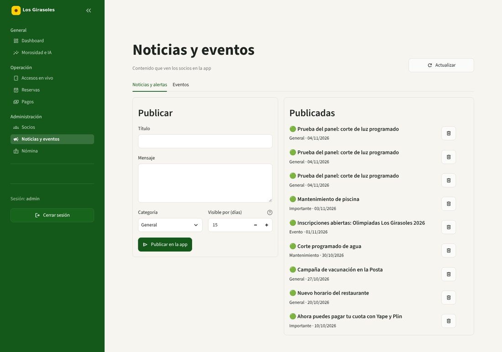
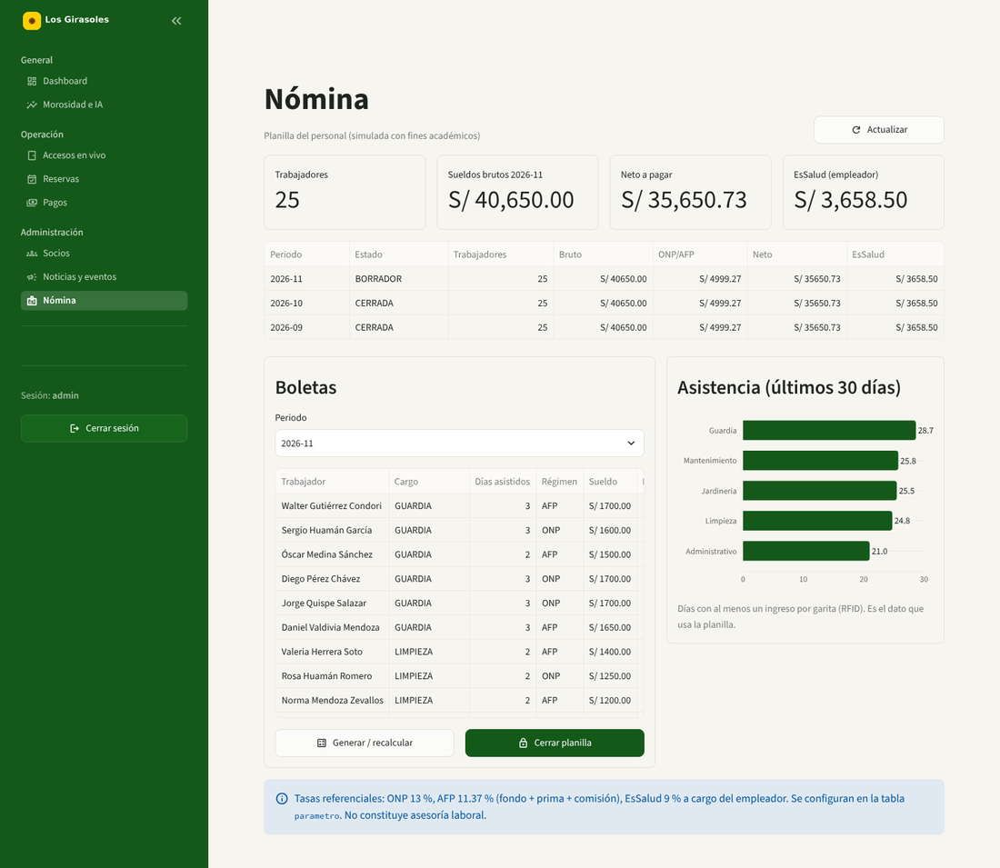

# Sprint 5 · Panel administrativo (Streamlit + Pandas) y modelo de riesgo de morosidad

**Objetivo del sprint:** dar a la administración un panel web con los indicadores del club, el
registro de la garita en tiempo real y un **componente de IA** que anticipe la morosidad, siguiendo
el prototipo de Figma del dashboard.

## Historias completadas

| ID | Historia | Criterio de aceptación | Estado |
|---|---|---|---|
| HU-34 | Como administrador quiero entrar al panel con mi usuario | Login contra la API; solo el rol ADMIN accede; la sesión expirada vuelve al login | ✅ |
| HU-35 | Como administrador quiero ver los KPIs del club de un vistazo (RF04) | Socios, reservas, recaudación, morosidad, socios al día y accesos del día | ✅ |
| HU-36 | Como administrador quiero ver quién entra y sale en tiempo real (RF05) | Registro actualizado cada 5 s sin recargar la página; filtro de denegados | ✅ |
| HU-37 | Como administrador quiero comprobar que la garita responde rápido (RNF02) | Histograma de latencias con p95 y % de validaciones < 2 s | ✅ |
| HU-38 | Como administrador quiero saber qué socios probablemente no pagarán este mes | Lista ordenada por probabilidad, con nivel, filtro y descarga CSV | ✅ |
| HU-39 | Como administrador quiero entender por qué el modelo marca a alguien | Métricas, comparación con regla simple, importancia de variables y limitaciones | ✅ |
| HU-40 | Como administrador quiero ver la ocupación de las instalaciones (RF02) | Mapa de calor día × hora, ocupación y agenda | ✅ |
| HU-41 | Como administrador quiero bloquear una instalación por mantenimiento | Formulario que llama a la API; desde ese momento la franja no admite nuevas reservas | ✅ |
| HU-42 | Como cajero quiero registrar un pago en ventanilla | Selección de cuota pendiente; el estado de cuenta se actualiza al instante | ✅ |
| HU-43 | Como administrador quiero buscar un socio y ver su ficha | Filtros por tipo, estado de pago y membresía; ficha, bloqueo de tarjeta y cambio de estado | ✅ |
| HU-44 | Como administrador quiero publicar noticias y eventos en la app (RF03) | Publicar / retirar noticias; crear eventos; ver inscripciones | ✅ |
| HU-45 | Como administrador quiero generar la planilla del personal (simulada) | Generar, revisar boletas y cerrar planilla; asistencia por la garita | ✅ |

## Decisiones técnicas

1. **Lectura directa, escritura por API.** El panel lee PostgreSQL con el rol `girasoles_dashboard`
   (solo lectura, sin acceso a usuarios, tokens QR ni claves de dispositivos) y **toda acción**
   pasa por el backend con el JWT del administrador. Las reglas de negocio no se duplican.
2. **Pandas para los cálculos** del panel (agrupaciones, tramos de deuda, mapas de calor), sobre
   vistas SQL ya preparadas en el Sprint 1 (`v_estado_cuenta`, `v_kpi_resumen`, `v_accesos_detalle`...).
3. **Caché por tipo de dato:** KPIs y gráficos con `st.cache_data` (TTL de 1 a 10 min), el modelo con
   `st.cache_resource` (1 h); los accesos **no** se cachean porque son en vivo.
4. **Tiempo real con `st.fragment(run_every="5s")`**: solo se vuelve a dibujar el bloque del registro,
   no la página completa.
5. **Visualización accesible:** paleta categórica validada para daltonismo, un solo tono de verde para
   magnitudes y los estados siempre con texto (nunca solo color). No hay gráficos de doble eje.
6. **Errores en español:** errores de la API, sesión expirada y caída de la base de datos muestran un
   mensaje claro en lugar de un traceback.
7. **Imagen Docker multi-etapa** (`pruebas` / `produccion`), usuario sin privilegios y healthcheck.

## Componente de IA: modelo de riesgo de morosidad

Metodología completa en [`dashboard/README.md`](../../dashboard/README.md#modelo-de-riesgo-de-morosidad).
Resumen:

- **Pregunta:** ¿el titular dejará de pagar la cuota del mes dentro de los 30 días de gracia?
- **Modelo:** regresión logística estandarizada (scikit-learn) con 8 variables de comportamiento de pago.
- **Validación temporal sin fuga de información:** entrena con 02–07/2026 (4 763 filas) y evalúa con
  08–09/2026 (1 630 filas); cada variable usa solo pagos anteriores al corte.

| Métrica (prueba) | Modelo | Regla simple "tiene cuotas vencidas" |
|---|---|---|
| AUC | **0.911** | 0.822 |
| Precisión en el 10 % de mayor riesgo | **34 %** | 31 % |
| Brier (calibración) | **0.057** | 0.134 |

Predicción para noviembre de 2026: **83 titulares en riesgo alto**, de los cuales **9 aún no son
morosos** (el grupo donde la prevención tiene más efecto), 74 en riesgo medio y 663 en riesgo bajo.

**Lo que corregimos en el camino:** la primera versión usaba `class_weight="balanced"` e inflaba las
probabilidades (31 % predicho frente a 7 % real); además tenía variables colineales que volvían
ininterpretables los coeficientes. Se quitó el balanceo, se redujeron las variables y la explicación
pasó a hacerse con importancia por permutación.

## Verificación

| Control | Resultado |
|---|---|
| Pruebas del modelo (`make test-dashboard`, pytest) | 12/12: fuga de información, pagos parciales, etiqueta con gracia, cortes observables, AUC y calibración en datos sintéticos, importancia de variables |
| Recorrido automatizado (Playwright) de las 8 páginas + acciones | 0 errores en pantalla y 0 errores en el log de Streamlit |
| Acción publicar noticia desde el panel | Se publica por la API y aparece en la lista del panel |
| Caída de la BD simulada | Mensaje "Sin conexión con la base de datos" en lugar de traceback |
| RNF02 (datos de la semana) | 100 % de 2 531 validaciones < 2000 ms; p95 = 868 ms |
| Dependencias en Python 3.13 (imagen Docker) | Todas con wheels oficiales |

## Capturas

| | |
|---|---|
|  |  |
|  |  |
|  |  |
|  |  |
|  |  |

## Siguiente sprint

Sprint 6: pruebas de extremo a extremo (app → garita → panel), evidencias de los RNF, manual de
usuario e informe final.
