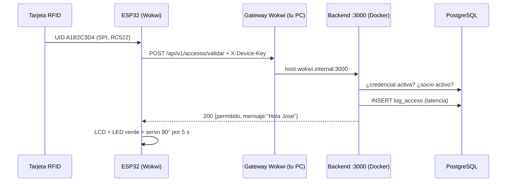

# Garita IoT · ESP32 + RFID (simulada en Wokwi)

Control de acceso del Club Residencial Los Girasoles. El ESP32 lee la tarjeta RFID,
consulta al backend y levanta la tranquera si el acceso es permitido.



## Circuito

| Componente | Pin del componente | ESP32 |
|---|---|---|
| Lector RC522 | SDA (CS) / SCK / MOSI / MISO / RST | 5 / 18 / 23 / 19 / 4 |
| | 3.3V / GND | 3V3 / GND |
| LCD 16×2 I2C (0x27) | SDA / SCL | 21 / 22 |
| Servo (tranquera) | PWM | 13 |
| LED verde / rojo (220 Ω) | ánodo | 26 / 27 |
| Zumbador | + | 25 |
| Interruptor entrada/salida | común | 33 (pull-up interno) |

## Tarjetas del simulador

Haz **clic en el lector RC522** dentro del simulador: se abre un panel donde eliges la tarjeta y presionas **Tap**
(o con el panel seleccionado: teclas `b g y r n k` para elegir y `t` para acercarla).

| Tarjeta | UID | Escenario | Resultado en el LCD |
|---|---|---|---|
| 🔵 Azul | `A1:B2:C3:D4` | José Miguel, socio 00247 | ✅ `Hola Jose` |
| 🟢 Verde | `11:22:33:44` | Roberto Silva, socio **moroso** | ✅ `Hola Roberto` (la deuda no impide entrar) |
| 🟡 Amarilla | `55:66:77:88` | Personal de limpieza | ✅ `Hola <nombre>` (marca asistencia) |
| 🔴 Roja | `AA:BB:CC:DD` | Tarjeta reportada como **perdida** | ⛔ `Tarjeta perdida` |
| 🔑 Llavero | `C0:FF:EE:99` | No registrada en el sistema | ⛔ `No registrada` |
| 🏷️ Tag NFC | `04:11:22:33:44:55:66` | Socio 00150 **suspendido** | ⛔ `Socio suspendido` |

El **interruptor** cambia el sentido: a la derecha ENTRADA, a la izquierda SALIDA (queda registrado en `log_acceso`).

## Puesta en marcha (Fedora)

### 1. El backend debe estar corriendo
Desde la raíz del repositorio:
```bash
make migrar        # una sola vez: registra los UIDs de las tarjetas de Wokwi en tu BD
make up
make tarjeta UID=A1B2C3D4   # prueba sin simulador: debe responder HTTP 200
```

### 2. Instalar VS Code (paquete oficial, no Flatpak)
La versión Flatpak aísla VS Code y PlatformIO no puede compilar. Usa el repositorio de Microsoft:
```bash
sudo rpm --import https://packages.microsoft.com/keys/microsoft.asc
echo -e "[code]\nname=Visual Studio Code\nbaseurl=https://packages.microsoft.com/yumrepos/vscode\nenabled=1\ngpgcheck=1\ngpgkey=https://packages.microsoft.com/keys/microsoft.asc" \
  | sudo tee /etc/yum.repos.d/vscode.repo > /dev/null
sudo dnf install -y code python3
```

### 3. Abrir el proyecto
```bash
code ~/los-girasoles/iot/garita-esp32
```
Abre **esta carpeta** (no la raíz del repo): PlatformIO necesita encontrar `platformio.ini`.
VS Code sugerirá instalar las extensiones recomendadas **PlatformIO IDE** y **Wokwi Simulator**: acepta.
La primera vez PlatformIO descarga el compilador del ESP32 (~400 MB); espera a que termine.

### 4. Activar la licencia de Wokwi (gratuita)
`F1` → **Wokwi: Request a New License** → se abre el navegador, inicias sesión y vuelves a VS Code.

### 5. Compilar y simular
1. Clic en ✓ **Build** en la barra inferior de PlatformIO (o `F1` → *PlatformIO: Build*).
   La primera compilación descarga las librerías (MFRC522, ArduinoJson, ESP32Servo, LiquidCrystal_I2C).
2. Abre `diagram.json` y luego `F1` → **Wokwi: Start Simulator**.
3. En el monitor serial verás:
   ```
   === Garita Los Girasoles de Huampani ===
   [rfid] RC522 listo (version 0x..)
   [red] Conectado. IP 10.13.37.2 | RSSI -56 dBm
   [api] Backend: http://host.wokwi.internal:3000/api/v1/accesos/validar
   ```
4. Clic en el lector → elige una tarjeta → **Tap**.

### Comandos por el monitor serial
Escribe en la terminal del simulador y presiona Enter:

| Comando | Qué hace |
|---|---|
| `GIR1:...` | Valida un QR dinámico (cópialo de `POST /accesos/qr` o de la app en el Sprint 4) |
| `uid A1B2C3D4` | Simula una tarjeta sin usar el panel del lector |
| `estado` | Muestra la red y las **métricas de latencia** (evidencia del RNF02) |
| `ayuda` | Lista los comandos y las tarjetas |

Ejemplo de salida por cada acceso:
```
[acceso] RFID A1B2C3D4 ENTRADA -> PERMITIDO (HTTP 200) "Hola Jose" José Miguel Quispe Soto | total 187 ms | servidor 3 ms
```
`total` es el tiempo de ida y vuelta medido en el ESP32; `servidor` es lo que tardó el backend en decidir.

## Diseño del firmware

```
src/
├── main.cpp          # ciclo principal, comandos seriales y métricas
├── LectorRfid.cpp    # RC522 por SPI, UID de 4 o 7 bytes
├── ClienteApi.cpp    # POST con API key, timeout de 1.8 s, interpretación de la respuesta
├── Barrera.cpp       # servo, LEDs y zumbador, todo no bloqueante
├── Pantalla.cpp      # LCD sin parpadeo y sin tildes
└── Red.cpp           # WiFi con reconexión automática
include/
├── config.h          # pines, URLs y tiempos (lo único que cambia para hardware real)
└── secretos.h        # API key del dispositivo (se crea sola desde secretos.h.example)
```

Decisiones:
- **Fail-secure:** si no hay red o el servidor no responde, la tranquera **no** se abre; el LCD pide llamar al guardia.
- **No bloqueante:** la tranquera se cierra sola con `millis()`, sin `delay()`, así el lector sigue atendiendo.
- **Antirrebote:** la misma tarjeta frente al lector no se valida dos veces en 3 s.
- **Credencial del dispositivo:** cada garita tiene su API key; en la BD solo se guarda su hash.
- **Verificado:** el código compila sin advertencias (`-Wall`) contra Arduino-ESP32 2.0.17, el core que instala PlatformIO.

## Pasar a hardware real

Solo cambia `include/config.h`: `WIFI_SSID`, `WIFI_PASSWORD` y `API_BASE_URL` (la IP del servidor).
El cableado de la tabla de arriba es el mismo con un ESP32 DevKit y un módulo RC522 físico.

## Problemas frecuentes

| Síntoma | Solución |
|---|---|
| LCD: `Servidor caido` | El backend no corre (`make up`) o no está en el puerto 3000. Prueba `make tarjeta`. |
| LCD: `Garita sin clave` | La API key de `include/secretos.h` no coincide con la BD. Bórralo y recompila. |
| `[rfid] ERROR: el RC522 no responde` | Revisa los cables SPI en `diagram.json` (SDA→5, RST→4). |
| Las tarjetas verde, amarilla, roja o NFC dan `No registrada` | Falta ejecutar `make migrar` en la raíz del repositorio. |
| `Wokwi: firmware not found` | Compila primero (Build); el simulador usa `.pio/build/garita/firmware.bin`. |
