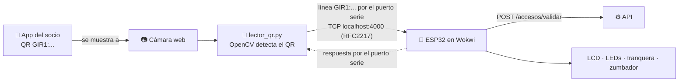

# Lector QR con cámara web para la garita en Wokwi

Permite mostrar el **QR de la app en el celular a la cámara web** y que la garita simulada en Wokwi
lo valide: el LCD muestra el resultado, se enciende el LED verde y se abre la tranquera, o el LED
rojo y el zumbador si se rechaza.



## Por qué funciona así

Wokwi no puede usar la cámara de la PC: el ESP32 simulado no tiene cámara y no existe un módulo
lector de QR en el simulador. En una garita real se usa un **módulo lector de QR** (por ejemplo, un
GM65) conectado al ESP32 por su **puerto serie (UART)**: el módulo lee el código y lo envía como una
línea de texto. Este programa cumple exactamente ese papel:

1. Abre la cámara web y detecta el QR con OpenCV.
2. Escribe `GIR1:...` en el puerto serie del ESP32 simulado. Wokwi lo expone como servidor TCP en
   `localhost:4000` (`rfc2217ServerPort` en `iot/garita-esp32/wokwi.toml`).
3. El firmware ya valida cualquier línea que empiece con `GIR1:` (Sprint 3), así que **la consulta a
   la API y la reacción del diagrama ocurren dentro de Wokwi**. El firmware no cambió.
4. Lee la respuesta del ESP32 y la muestra en la ventana de la cámara (franja verde o roja).

Con hardware real, el mismo firmware funcionaría conectando un lector GM65 al UART del ESP32.

## Cómo usarlo

1. Levanta el sistema: `make up`.
2. En VS Code abre `iot/garita-esp32`, haz **Build** e inicia **Wokwi: Start Simulator**.
3. En otra terminal, desde la raíz del repositorio:

   ```bash
   make camara              # la primera vez instala OpenCV en iot/lector-qr/.venv
   make camara CAMARA=1     # si tienes varias cámaras
   ```

4. En la app: **Mi QR** → muestra el celular a la cámara, con el brillo de la pantalla alto.
5. Mira el diagrama de Wokwi: LCD, LED y tranquera reaccionan. Cada QR es de **un solo uso**: para
   volver a entrar genera uno nuevo en la app.

Salir: tecla `Q` en la ventana de la cámara (o `Ctrl+C`).

| Opción | Uso |
|---|---|
| `--camara 1` | Otra cámara (`ls /dev/video*` lista las disponibles) |
| `--camara video.mp4` o una URL | Un video o una cámara IP en lugar de la cámara web |
| `--imagen qr.png` | Lee el QR de una imagen y lo envía (prueba sin cámara) |
| `--puerto 4000` | Debe coincidir con `rfc2217ServerPort` de `wokwi.toml` |
| `--sin-ventana` | Sin ventana (solo mensajes en la terminal) |

## Fedora en VirtualBox: pasar la cámara a la máquina virtual

La cámara de la laptop pertenece a Windows (el anfitrión); hay que prestársela a Fedora:

1. Instala el **Extension Pack** de VirtualBox, de la misma versión que tu VirtualBox
   (virtualbox.org → Downloads), y reinicia VirtualBox.
2. Con la máquina virtual encendida: menú **Dispositivos → Cámaras web →** marca tu cámara.
3. En Fedora comprueba que apareció: `ls /dev/video*` (debe salir `/dev/video0`).
4. Cierra en Windows cualquier programa que use la cámara (Zoom, Teams, la app Cámara).

## Problemas frecuentes

| Síntoma | Solución |
|---|---|
| `No se pudo abrir la cámara '0'` | La cámara no está pasada a la VM (ver arriba) o es otro índice: `make camara CAMARA=1` |
| "Esperando la simulación de Wokwi en localhost:4000" | Inicia el simulador en VS Code. Si lo iniciaste antes de hacer `git pull`, deténlo y vuelve a iniciarlo para que lea el nuevo `wokwi.toml` |
| No detecta el QR | Sube el brillo del celular, acércalo a unos 30 cm y evita reflejos de lámparas en la pantalla |
| "QR ya leído: genere uno nuevo en la app" | El QR es de un solo uso: en la app vuelve a generar el código |
| `libGL.so.1: cannot open shared object file` | `sudo dnf install mesa-libGL` |
| La garita responde "QR ya utilizado" | Ese QR ya se usó (por ejemplo, desde el monitor serial). Genera uno nuevo |

## Pruebas

```bash
make test-lector
```

Son 19 pruebas sin cámara ni Wokwi:
- detección de QR como los de la app, fotografiados con ángulo, reflejo, desenfoque y compresión JPEG;
- un servidor falso que imita el RFC2217 de Wokwi y la respuesta del firmware;
- el flujo completo con un video en lugar de la cámara: un QR visto en 40 cuadros se envía una sola vez.

También corren en la integración continua.
