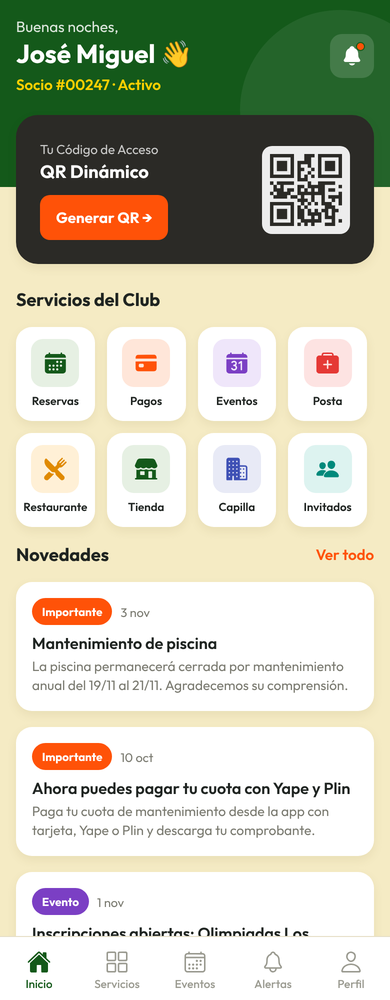
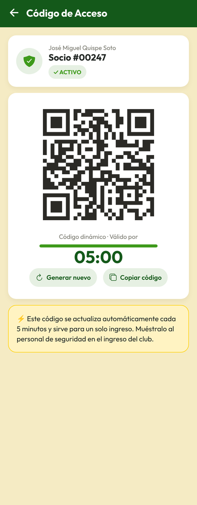
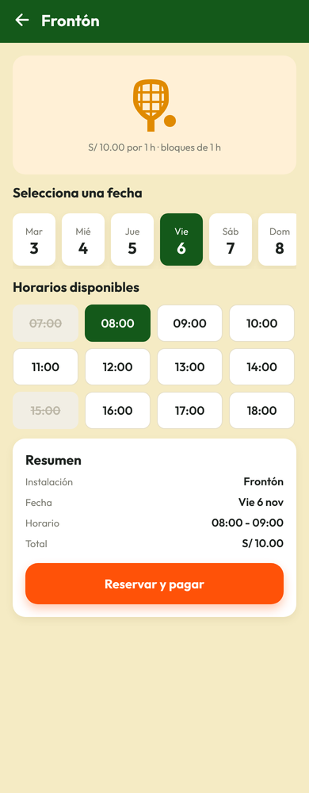
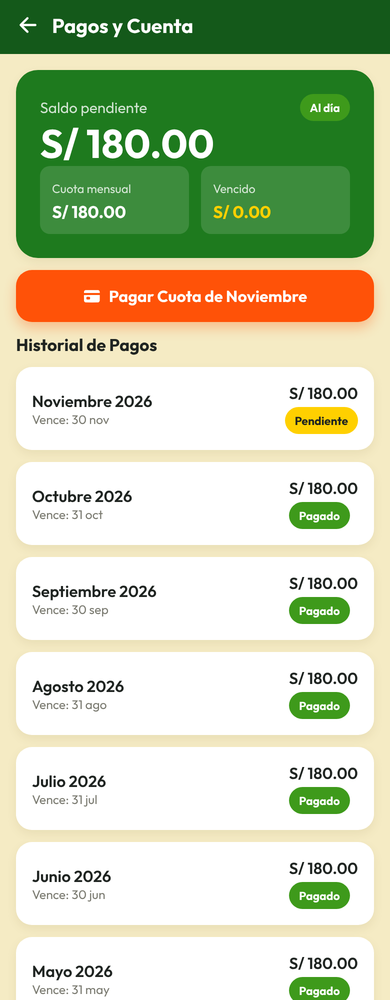

# App móvil · Los Girasoles (React Native + Expo SDK 58)

App para los socios del Club Residencial Los Girasoles de Huampaní: QR dinámico de acceso,
reservas con pago, estado de cuenta, eventos, alertas, tienda, invitados y perfil.

<p align="center">
  
  
  
  
</p>

## Requisitos

| Qué | Dónde |
|---|---|
| Backend corriendo (`make up` en la raíz) | Tu PC con Fedora |
| Node.js 20 o superior | `sudo dnf install -y nodejs` (Fedora 41+ trae Node 22) |
| App **Expo Go** (versión para SDK 58) | [Android](https://play.google.com/store/apps/details?id=host.exp.exponent) · [iPhone](https://apps.apple.com/app/expo-go/id982107779) |
| Celular y PC en la **misma red WiFi** | — |

## Ejecutar

```bash
cd ~/los-girasoles/mobile
npm install          # solo la primera vez
npx expo start
```

Aparece un código QR en la terminal:
- **Android:** ábrelo con la app Expo Go (botón *Scan QR code*).
- **iPhone:** escanéalo con la cámara y toca el aviso para abrir en Expo Go.

Inicia sesión con el socio de demostración **00247** / **Girasoles2026**
(o **00289** para ver cómo se bloquean las reservas de un socio moroso).

### ¿Cómo encuentra la app al backend?
Sola. Expo Go descarga la app desde tu PC (ej. `192.168.1.20:8081`), así que la app usa esa misma IP
con el puerto 3000. En la pantalla de login, debajo de la versión, se muestra la dirección que está usando.
Para forzar otra: `EXPO_PUBLIC_API_URL=http://192.168.1.20:3000/api/v1 npx expo start`.

### Sin celular: versión web
```bash
npx expo start --web
```
Se abre en el navegador de la PC con la misma funcionalidad (útil para grabar la demo).

## Problemas frecuentes

| Síntoma | Solución |
|---|---|
| Login: "No se pudo conectar con el servidor" | ¿Corre el backend? `curl localhost:3000/api/v1/health`. ¿Celular en el mismo WiFi que la PC? |
| Sigue sin conectar desde el celular | Revisa el firewall: `sudo firewall-cmd --get-default-zone`. En *FedoraWorkstation* los puertos 1025-65535 ya están abiertos; en otra zona: `sudo firewall-cmd --add-port={3000,8081}/tcp --permanent && sudo firewall-cmd --reload && sudo systemctl restart docker` |
| La red de la universidad no deja conectar dispositivos entre sí | Comparte internet desde tu celular (hotspot) y conecta la PC a esa red, o usa la versión web |
| Expo Go dice "Project is incompatible with this version of Expo Go" | Actualiza Expo Go desde la tienda: el proyecto usa el SDK 58 |
| Cambios en el código no se ven | Agita el celular → *Reload*, o presiona `r` en la terminal de Expo |

## Estructura

```
src/
├── app/                      # Expo Router: cada archivo es una pantalla
│   ├── _layout.tsx           # fuentes + sesión + rutas protegidas (Stack.Protected)
│   ├── login.tsx
│   └── (app)/                # solo con sesión iniciada
│       ├── (tabs)/           # Inicio · Servicios · Eventos · Alertas · Perfil
│       ├── qr.tsx            # QR dinámico (5 min, un solo uso, se renueva solo)
│       ├── reservas/         # instalaciones del día, franjas, mis reservas
│       ├── pagos/            # estado de cuenta y pago (pasarela simulada)
│       ├── servicio/[tipo].tsx  # posta, capilla, restaurante
│       ├── tienda.tsx
│       └── invitados.tsx     # registro de visitas con QR para compartir
├── api/                      # cliente HTTP, detección de la IP del backend, tipos
├── sesion/                   # token en SecureStore (Keychain / Keystore)
├── componentes/              # encabezado, tarjetas, botones, selector de fecha...
├── hooks/useConsulta.ts      # carga de datos con recarga al volver a la pantalla
├── tema/                     # colores y tipografía (Outfit) del prototipo Figma
└── utils/                    # formatos de soles y fechas en hora de Lima
```

## Calidad

```bash
npm run typecheck   # TypeScript estricto (incluye rutas tipadas de Expo Router)
npm run lint        # ESLint con la configuración oficial de Expo
npx expo-doctor     # diagnóstico de dependencias del SDK 58
```
